<div align="center">



<a href="https://github.com/YosorTV">
  
</a>

<br/>

<a href="https://alieksandrov.dev"></a>
<a href="https://www.linkedin.com/in/yevhenii-alieksandrov/"></a>
<a href="mailto:yosorit@gmail.com"></a>


</div>

---

### About me

```ts
const yevhenii = {
  role: "Senior Frontend Engineer",
  focus: "Frontend core, fullstack delivery with AI agents",
  experience: "7+ years in production web & mobile",
  basedIn: "Dnipro, Ukraine, open to remote and EU relocation",
  buildsWith: {
    frontend: ["React", "Next.js", "TypeScript", "Zustand", "Mantine", "AG Grid"],
    backend: [".NET / C#", "Node.js", "PostgreSQL", "Azure SQL", "SignalR", "GraphQL"],
    mobile: ["Flutter", "Dart"],
    ai: ["Claude Code", "MCP servers", "multi-agent workflows", "LLM APIs"],
  },
  domains: ["Maritime & shipping SaaS", "B2B platforms with RBAC", "Safety-tech", "E-commerce"],
  motto: "Engineers decide. Agents accelerate.",
};
```

### What I'm doing now

- Designed and rolled out an **agent-orchestrated development workflow** that a whole engineering team works in: 12 per-stack Claude Code agents (implementer, reviewer, investigator), reusable skills, quality-gate hooks, governed TDD and in-house **MCP servers** for Azure DevOps, Application Insights and Jam.
- Shipping fullstack features on **maritime SaaS** (port-call management and bunker trading) with a .NET backend, React frontend and real-time collaboration over SignalR.
- Took two **Flutter apps** for a safety-tech platform from concept to App Store and Google Play release.

### Tech stack

<p align="center">
  <br/>
  <br/>
  
</p>
<p align="center">
  
  
  
  
  
</p>

### Featured projects

<p align="center">
  <a href="https://github.com/YosorTV/claude-agent-workflow">
    
  </a>
  <a href="https://github.com/YosorTV/kush-jewelry-front">
    
  </a>
</p>

- **claude-agent-workflow**: reference implementation of the workflow above, with per-stack agent roles, hand-off contracts, quality gates that fail closed, and a working MCP server.
- **kush-jewelry-front**: storefront of [KUSH Jewelry](https://www.kush.jewelry/en), a production e-commerce app built freelance in 2024: Next.js 14 storefront on Vercel, Strapi backend on AWS, LiqPay checkout, Nova Post delivery and UA / EN localization.

### Products I've built

| Product | What it is | My part |
| --- | --- | --- |
| **Beacon52** | Port-call management SaaS (public clients include Neste, Stolt Tankers) | Voyage, vessel and cargo modules, RBAC, real-time collaboration over SignalR |
| **Bunker Suite** | Bunker-trading SaaS for brokers, traders and suppliers | Fullstack features on .NET (CQRS, event sourcing) and React 18, Playwright E2E |
| **CYSafe** | Safety-management platform | Two Flutter apps shipped to the stores, React CRM portal on a .NET backend |
| **Lenovo Studio AI** | Internal generative-AI content platform for Lenovo marketing | Frontend architecture, CopyAI integration |
| **KUSH Jewelry** | [kush.jewelry](https://www.kush.jewelry/en): jewelry e-commerce (freelance, 2024) | Built it fullstack as sole developer: Next.js 14, Strapi, DaisyUI, Cloudinary, Resend, LiqPay, Nova Post, bilingual UA / EN; Vercel + AWS |
| **Mallprix** | Multi-category retail e-commerce | Full rebuild: Next.js 14 to 16, Node.js + PostgreSQL + Docker backend |
| **Ship.Link** | Global vessel-chartering marketplace | SSR marketing site on Strapi and a role-based SPA with SignalR |

### GitHub activity

<p align="center">
  
  
</p>
<p align="center">
  
</p>

<p align="center">
  <picture>
    <source media="(prefers-color-scheme: dark)" srcset="https://raw.githubusercontent.com/YosorTV/YosorTV/output/github-snake-dark.svg" />
    <source media="(prefers-color-scheme: light)" srcset="https://raw.githubusercontent.com/YosorTV/YosorTV/output/github-snake.svg" />
    
  </picture>
</p>


